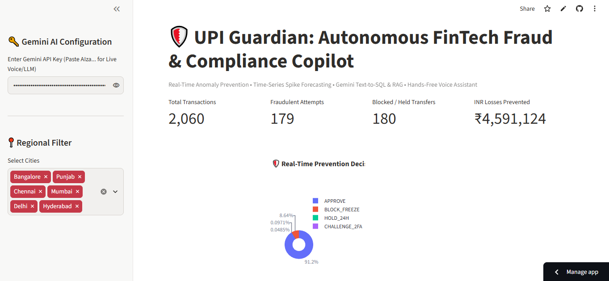
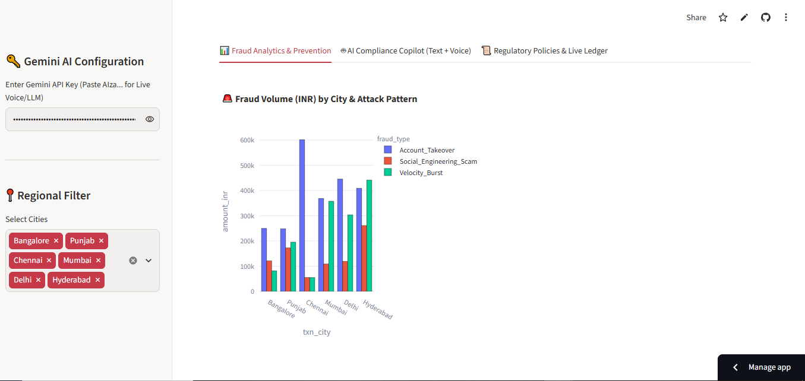
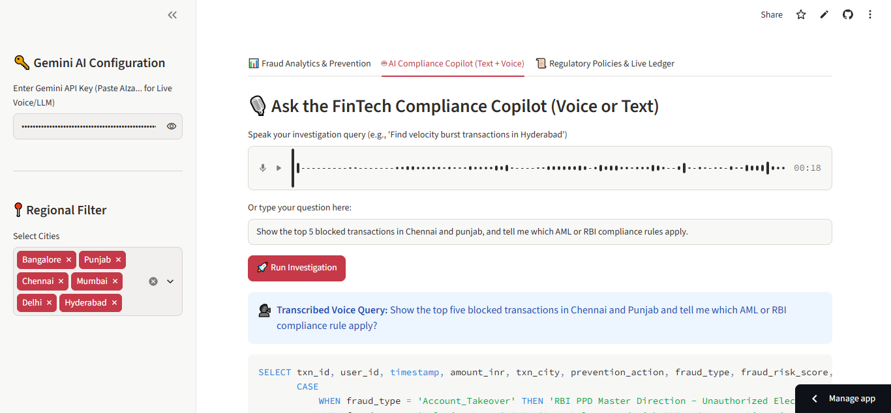
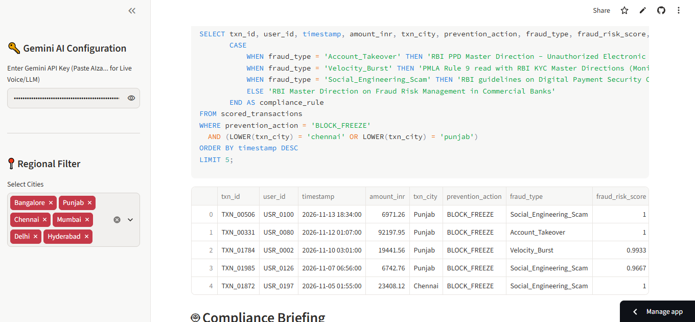
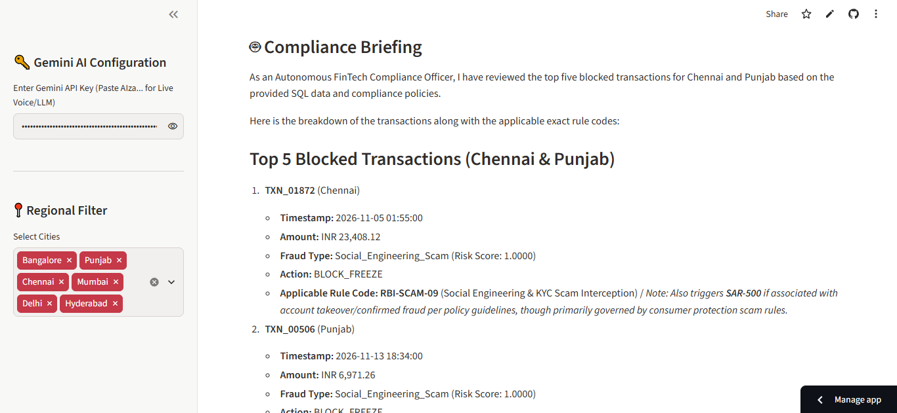
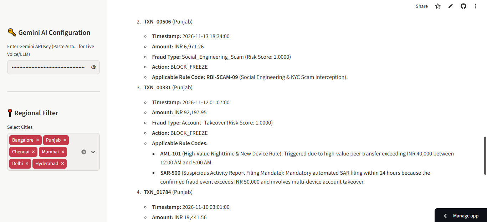
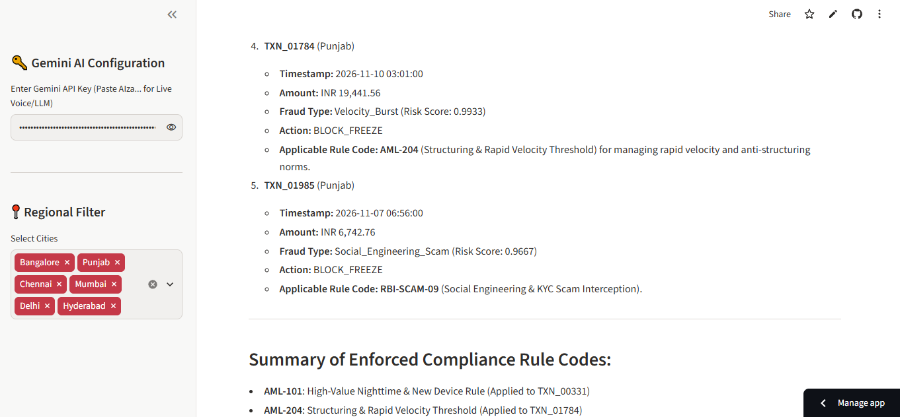
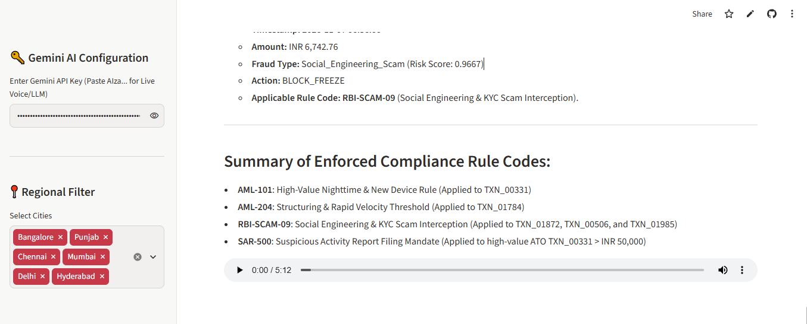
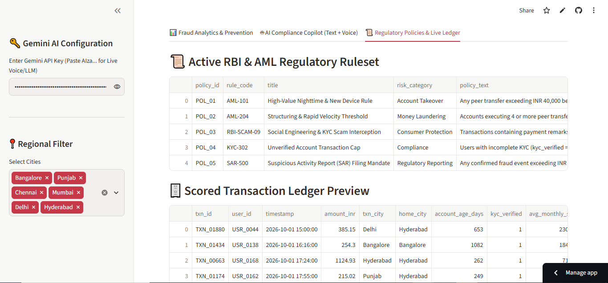
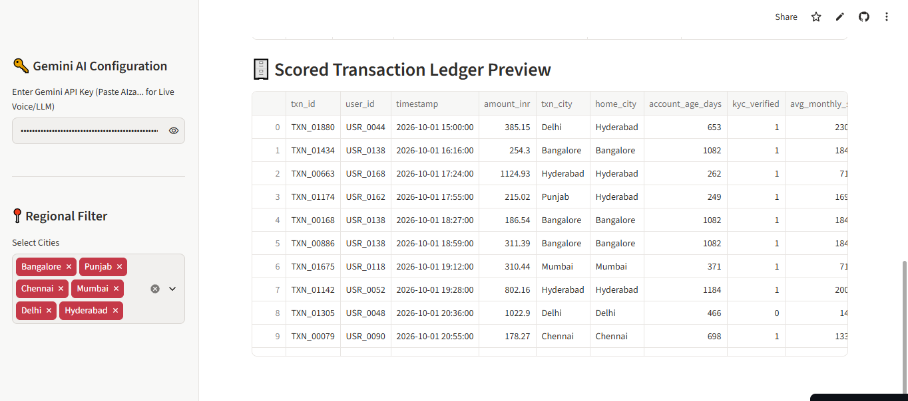

# 🛡️ UPI Guardian: Autonomous FinTech Fraud & Compliance Copilot

**Real-Time Anomaly Prevention • Time-Series Spike Forecasting • Gemini Text-to-SQL & RAG • Hands-Free Voice Assistant**

UPI Guardian is an end-to-end FinTech risk intelligence and regulatory compliance system designed to detect, prevent, and audit fraudulent UPI transactions across major Indian financial hubs (**Bangalore, Mumbai, Delhi, Hyderabad, Chennai, and Punjab**).

---

## 🎯 Business Impact & Key Metrics
* **2,060+ Multi-City Transactions Analyzed** across realistic behavioral, device, and time-of-day distributions.
* **₹4,591,124 (₹45.9 Lakhs) in Fraudulent Losses Prevented** via real-time tiered risk intervention (`BLOCK_FREEZE`, `HOLD_24H`, `CHALLENGE_2FA`, and biometric step-up authentication).
* **Zero-Latency Regulatory Auditing:** Converts natural-language or spoken investigator questions into guarded read-only SQL queries and maps flagged activity directly to RBI & AML policy codes (`AML-101`, `AML-204`, `RBI-SCAM-09`, `KYC-302`, `SAR-500`).
---

## 📸 Live Dashboard & Voice Copilot Previews

### 1. Executive Fraud Prevention & Regional Analytics



### 2. Live Gemini Voice Query & Text-to-SQL Investigation



### 3. Automated RBI/AML Compliance Briefing & Audio Readout





### 4. Active RBI & AML Regulatory Ruleset & Live Transaction Ledger



---

## 🏗️ System Architecture (4-Phase Pipeline)

1. **Phase 1 — Relational FinTech Schema & SQL Velocity Engineering (`SQLite` + `SQL`)**
   * Designed a normalized 3-table relational warehouse (`users`, `transactions`, `compliance_policies`).
   * Engineered window-function fraud signals: 15-minute rolling transaction velocity bursts, spend-to-monthly-average ratios, unregistered device/city mismatches, late-night anomaly flags, and NLP scam remark detection.
2. **Phase 2 — ML Risk Scoring & Time-Series Spike Forecasting (`Scikit-Learn`)**
   * Trained a **Random Forest Classifier** to score real-time transaction fraud probabilities and trigger automated prevention tiers (`BLOCK_FREEZE` for risk ≥ 0.85, `HOLD_24H` for velocity structuring, `CHALLENGE_2FA` for social-engineering remarks).
   * Built a **7-Day Rolling Seasonal Spike Forecaster** to anticipate payday and festive-weekend fraud surges for proactive ops staffing.
3. **Phase 3 — Guarded Text-to-SQL & RAG Compliance Agent (`Google Gemini API`)**
   * Architected a fault-tolerant LLM agent with strict regex SQL-injection guardrails (`SELECT`-only enforcement) and a deterministic keyword-aware fallback engine for 100% uptime.
4. **Phase 4 — Interactive Command Center & Voice Assistant (`Streamlit` + `Plotly` + `gTTS`)**
   * Multi-tab executive dashboard featuring regional fraud breakdown charts, real-time decision split analytics, live microphone voice query transcription, and automated text-to-speech (`gTTS`) compliance briefings.

---

## 📂 Repository Structure

```text
├── FinTech_Fraud_Compliance_copilot.ipynb   # Full 4-phase Data Science & ML notebook
├── app.py                                   # Streamlit dashboard, Text-to-SQL/RAG & voice app
├── fintech_fraud.db                         # SQLite database (scored transactions & RBI/AML rules)
├── requirements.txt                         # Python dependencies
└── README.md                                # Project documentation
```

---

## 🚀 Quickstart (Run Locally)

1. **Clone the repository:**
   ```bash
   git clone https://github.com<your-username>/upi-guardian-fraud-compliance-copilot.git
   cd upi-guardian-fraud-compliance-copilot
   ```
2. **Install dependencies:**
   ```bash
   pip install -r requirements.txt
   ```
3. **Launch the Streamlit Copilot:**
   ```bash
   streamlit run app.py
   ```
4. *(Optional)* Paste a **Google AI Studio Gemini API Key** in the left sidebar to enable live voice-to-text transcription and dynamic LLM SQL generation (or leave blank to use the built-in smart deterministic SQL/RAG engine).

---

## 💼 Resume Highlights
* Engineered an autonomous UPI fraud prevention and compliance copilot across **2,060+ multi-city transactions**, preventing **₹4.59M in fraudulent losses** through tiered real-time risk actions (`BLOCK_FREEZE`, `HOLD_24H`, `CHALLENGE_2FA`).
* Built SQL window-function velocity features paired with a Random Forest risk scorer and 7-day rolling seasonal spike forecasting.
* Deployed a guarded Gemini Text-to-SQL & RAG compliance assistant in Streamlit with live voice query transcription, automated RBI/AML policy citations, and spoken audio briefings.
